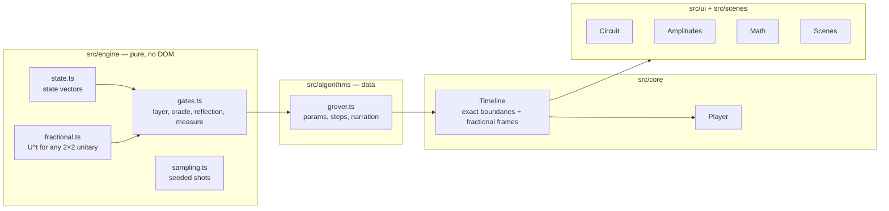

# Quantum Stepper

Step through quantum algorithms gate by gate. The circuit, the geometry, the amplitudes and the math stay in sync, and every gate animates continuously along the path U<sup>t</sup> instead of snapping from one state to the next.

> Add a 20-second GIF of a Grover run here.

**Algorithms:** Grover’s search (2–5 qubits) and Deutsch–Jozsa (1–4 input qubits plus an ancilla, with constant and balanced oracles).

## What you see

| View | What it shows |
| --- | --- |
| Circuit timeline | The gates, iteration brackets and a playhead. Click any gate to play it. |
| Signature scene | One visual per algorithm. For Grover, the 2D plane where each iteration is two reflections that add up to a rotation by 2θ. For Deutsch–Jozsa, one arrow per input added tip to tail: the terms of the \|0…0⟩ amplitude under H<sup>t</sup>, which line up for a constant oracle and cancel for a balanced one. |
| Amplitudes | Real parts as signed bars, complex phase as dials, the mean as a dashed line, and the pre-gate amplitudes as ghosts. At measurement: 1,024 sampled shots against the exact \|a\|². |
| Math notebook | The formula for the current gate, filled in with the live numbers. Hover a term to highlight its bars and vice versa. |
| Why √N | The success curve sin²((2k+1)θ) with a dot that follows the simulated state, so over-rotation is visible. |

## Run it

```bash
npm install
npm run dev        # local dev server
npm test           # engine, algorithm, Qiskit cross-check and visual tests
npm run build      # type-check and produce a static site in dist/
```

The build is fully static (about 15 kB gzipped JS), so it deploys anywhere: GitHub Pages, Netlify, Vercel.

## Architecture



- **`src/engine`** is a dependency-free state-vector simulator. Every gate exposes `apply(state, t)`, which returns the state after U<sup>t</sup>. It never touches the DOM, so it is easy to test.
- **`src/algorithms`** holds one file per algorithm. Each one is data: parameter specs, the list of steps, a role for each basis state (which one gets the accent colour), facts, a narration function for the math panel, and its signature scenes.
- **`src/core`** has the `Timeline`, which precomputes the exact state at every step boundary and renders any in-between frame by applying the current gate fractionally, and the `Player`, which handles playback.
- **`src/ui`** holds the shared views. They know nothing about any specific algorithm.

## How the animation stays honest

A frame at time *t* through a gate shows the state after U<sup>t</sup>, the principal fractional power of the gate. So the in-between frames are real quantum states on the shortest path, not visual tweens.

- **Single-qubit gates.** Write U = e<sup>iα</sup>V with V ∈ SU(2), and V = cos(β/2)I − i sin(β/2)(n·σ). Then U<sup>t</sup> = e<sup>iαt</sup>[cos(βt/2)I − i sin(βt/2)(n·σ)]: a rotation about a fixed Bloch axis. For H this is a π rotation about (x+z)/√2, so mid-gate amplitudes pass through complex values (the phase dials show this).
- **Reflections.** Grover's oracle and diffusion are reflections R = I − 2P, and R<sup>t</sup> = I + (e<sup>iπt</sup> − 1)P. The oracle turns the marked phase from 0 to π. The diffusion keeps the |s⟩ component and turns the phase of everything orthogonal to it.
- **Diagonal oracles.** e<sup>iφ(x)</sup> becomes e<sup>iφ(x)t</sup>.
- **Bit oracles.** U<sub>f</sub>\|x⟩\|y⟩ = \|x⟩\|y ⊕ f(x)⟩ is a reflection that applies X to y wherever f(x) = 1, so U<sub>f</sub><sup>t</sup> applies X<sup>t</sup> there. With y in \|−⟩ (an X eigenvector), \|x⟩ picks up e<sup>iπf(x)t</sup>: phase kickback, animated.

The tests check that U<sup>0</sup> = I, U<sup>1</sup> = U, U<sup>t</sup> stays unitary, and U<sup>a</sup>U<sup>b</sup> = U<sup>a+b</sup>.

## Validated against Qiskit

`scripts/qiskit_fixtures.py` builds the same circuits in Qiskit and records the state vector after every step. `tests/qiskit.test.ts` checks every amplitude at every step boundary to within 10<sup>−9</sup>.

- **Grover:** H layers and `DiagonalGate` oracles, with diffusion as H·(2\|0⟩⟨0\| − I)·H, for 2–5 qubits, several marked states, and iteration counts past the optimum.
- **Deutsch–Jozsa:** X on the ancilla, H layers, and the oracle as one multi-controlled X per input with f(x) = 1, for 1–4 input qubits and every oracle. The test also checks that both sides use the same truth table.

```bash
pip install qiskit
npm run fixtures   # regenerate tests/fixtures/*.json
npm test
```

## Testing the visuals

The scenes, bars and math notebook only write SVG or HTML strings, so the tests draw them in Node and read the picture back. They check the drawing against the mathematics, not against the drawing code:

- **Math notebook** (`tests/math-panel.test.ts`): every number printed in the card equals the live state or its closed form, at frames all through each gate.
- **Scenes** (`tests/scenes.test.ts`): the Grover arrow sits at (2k+1)θ after k iterations and moves in a straight line across the right mirror mid-reflection; the P(k) dot lands on the curve at whole k; the Deutsch–Jozsa resultant is the live amplitude, with one zoom factor for the whole step.
- **Amplitudes** (`tests/bars.test.ts`): bar heights are real parts, dials point at the phase, and the histogram counts only the measured qubits.
- **Playback** (`tests/player.test.ts`): next, previous, click-to-play and seek land on the right step boundaries.

## Adding an algorithm

Create `src/algorithms/<name>.ts` that exports an `AlgorithmDefinition`, then add it to the list in `src/algorithms/index.ts`. The skeleton:

```ts
export const myAlgo: AlgorithmDefinition<{ n: number }> = {
  id: 'my-algo',
  title: 'My algorithm',
  headline: 'in one line',
  intro: 'One paragraph for the header.',
  params: [{ key: 'n', label: 'Qubits', options: () => [2, 3, 4].map(n => ({ value: n, label: String(n) })) }],
  defaults: { n: 3 },
  normalize: p => p,
  build({ n }) {
    return {
      n,
      steps: [{ gate: layer('Hadamard', 'H', MATRICES.H, n) }, { gate: measurement(n) }],
      brackets: [],
      role: x => (x === 0 ? 'focus' : 'rest'),
      facts: [],
      narrate: ctx => ({ title: '…', equation: '…', rows: [], note: '…' }),
      scenes: [],          // optional signature visuals
      seed: 1,
    };
  },
};
```

New gate types go in `src/engine/gates.ts`. A gate only needs `apply(state, t)` plus a glyph for the circuit; anything with a closed-form fractional power fits.

## Roadmap

- Bernstein–Vazirani, QFT, phase estimation, Shor for N = 15
- Controlled gates in the engine
- Predict-before-reveal prompts for students
- Deep links to a specific step for lecture slides
- Arabic interface

## License

MIT
